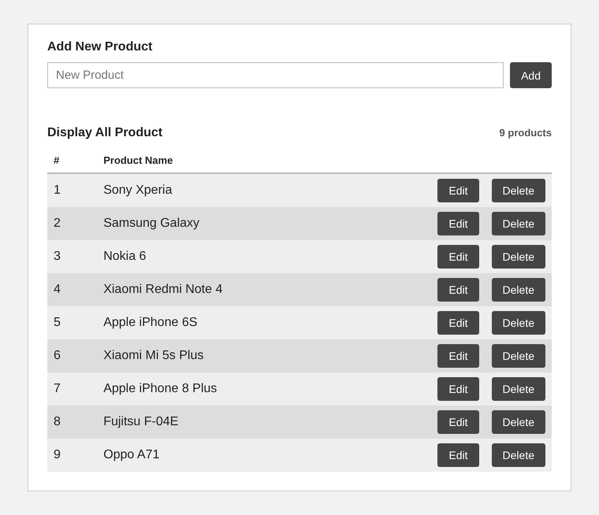

# Bài 3.3 – Ứng dụng Quản lý sản phẩm

Bài tập JavaScript trong sách *Bài tập Thiết kế Web*, mục **3.3. Ứng dụng Quản lý sản phẩm** (Hình 3.4).

## Kết quả



## Yêu cầu

Luyện tập mảng và hàm qua một "ứng dụng quản lý" có các chức năng:

- Hiển thị danh sách sản phẩm trên bảng (số thứ tự, tên sản phẩm, nút sửa, nút xóa)
- Thêm sản phẩm mới: nhập tên rồi bấm **Add**
- Sửa tên sản phẩm: bấm vào tên hoặc nút **Edit**, tên hiện lên ô sửa; sửa xong bấm **Update**
- Xóa sản phẩm: bấm nút **Delete**

## Các bước theo hướng dẫn 3.3.3

| Bước | Trong `script.js` |
|---|---|
| 2. Tạo mảng chứa danh sách sản phẩm | `danhSachSanPham` |
| 4. Hiển thị danh sách bằng vòng lặp | `hienThiDanhSach()` |
| 5. Thêm sản phẩm vào danh sách | `themSanPham()` |
| 6. Sửa tên sản phẩm | `chonSua(viTri)`, `capNhatSanPham()` |
| 7. Xóa sản phẩm khỏi danh sách | `xoaSanPham(viTri)` |

## Cấu trúc

```
js-quan-ly-san-pham/
├── index.html       # form thêm, form sửa, bảng danh sách
├── style.css
├── script.js
└── screenshot.png   # ảnh kết quả
```

## Kiến thức JavaScript sử dụng

- Mảng: `push()` để thêm, gán `mang[i] = …` để sửa, `splice(viTri, 1)` để xóa, `length` để đếm
- Vòng lặp `for` dựng các dòng của bảng rồi gán vào `innerHTML`
- Hàm có tham số (vị trí của sản phẩm trong mảng)
- Kiểm tra dữ liệu: không cho tên rỗng hoặc trùng với sản phẩm đã có
- `confirm()` hỏi lại trước khi xóa
- Đổi các ký tự `< > & " '` trước khi đưa tên vào `innerHTML`, để tên sản phẩm không bị hiểu thành mã HTML

## Cách chạy

Tải repo về (**Code → Download ZIP**) rồi mở file `index.html` bằng trình duyệt. Dữ liệu chỉ lưu trong mảng, nên tải lại trang sẽ trở về danh sách ban đầu.
